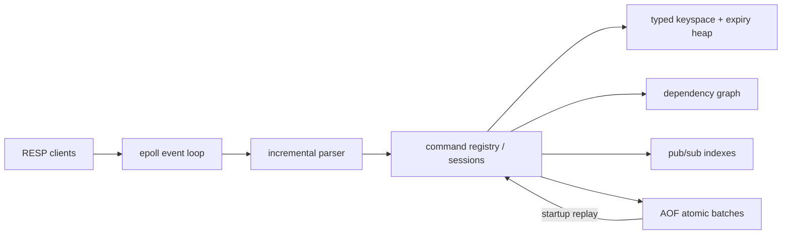

# KeyForge

KeyForge is an educational, production-style, single-node in-memory datastore written
in C++20. It implements a **Redis-compatible subset** over RESP2 with a Linux `epoll`
event loop, typed values, deterministic expiry, optimistic transactions, append-only
recovery, pub/sub, and an original dependency-aware cache invalidation graph. It is a
portfolio and learning system—not production-ready and not a drop-in Redis replacement.

## Why it is more than a key/value map

The reusable `keyforge_core` library owns a binary-safe incremental parser, non-blocking
connection state, a command registry, five value types, an indexed sorted set, lazy and
active TTL expiry, absent-key version tracking for WATCH, atomic AOF batches, pub/sub
fan-out, and iterative graph algorithms. The server handles fragmented and pipelined
traffic without assuming that one `recv` call contains one command.

| Area | Implemented behavior |
|---|---|
| Networking | IPv4 TCP, level-triggered `epoll`, non-blocking accept/read/write, bounded buffers, `signalfd` shutdown |
| Protocol | Incremental, binary-safe RESP2 values and command arrays |
| Data | Strings, lists, hashes, sets, sorted sets with score/member ordering |
| Expiry | Lazy access checks plus bounded event-loop work over a stale-record-safe min-heap |
| Transactions | MULTI/EXEC/DISCARD and WATCH/UNWATCH, including absent and expired keys |
| Persistence | RESP AOF, atomic batches, absolute TTLs, `always`/`everysec`/`no`, truncated-tail recovery |
| Messaging | SUBSCRIBE/UNSUBSCRIBE/PUBLISH with two-way indexes and normal backpressure |
| Original extension | Cycle-safe dependency graph and transitive cache invalidation |

## Dependency-aware invalidation

Cache entries can declare what source keys they depend on. Graph direction is parent to
dependent child, so invalidation follows the same direction as staleness:

```text
product:42 ──> product-page:42 ──> homepage:featured
          └─> recommendation:user:7
```

```bash
redis-cli -p 6380 MSET product:42 data product-page:42 html \
  homepage:featured html recommendation:user:7 json
redis-cli -p 6380 KFG.DEPEND product-page:42 product:42
redis-cli -p 6380 KFG.DEPEND homepage:featured product-page:42
redis-cli -p 6380 KFG.DEPEND recommendation:user:7 product:42
redis-cli -p 6380 KFG.INVALIDATE product:42
# (integer) 4
```

Registration requires all keys to exist, rejects self-edges and cycles before mutation,
and de-duplicates edges. `DEL` removes only named values and their incident edges;
`KFG.INVALIDATE` and parent expiry remove every transitive dependent using iterative BFS.
Every removed key receives a new WATCH version, and graph changes are recovered from AOF.

## Architecture



One event-loop thread owns command execution and the keyspace, making individual commands
and EXEC batches atomic relative to other clients. Only `everysec` fsync runs in a
background thread. File descriptors and the worker thread have explicit RAII ownership.
See [docs/architecture.md](docs/architecture.md) for the detailed flow. For a guided tour
through every subsystem, debugger exercises, and a prioritized improvement backlog, use
[docs/code-reading-guide.md](docs/code-reading-guide.md).

## Prerequisites and build (WSL/Ubuntu)

The supported baseline is WSL2 or Linux, Ubuntu 22.04 or newer, CMake 3.24+, Ninja,
GCC 12+ or Clang 15+. Ubuntu 22.04's older GCC/CMake also builds the current source, but
the documented portfolio baseline is used in CI/container workflows.

```bash
sudo apt update
sudo apt install -y build-essential cmake ninja-build clang clang-tidy clang-format \
  redis-tools git

cmake --preset debug
cmake --build --preset debug -j
ctest --preset debug --output-on-failure
```

Catch2 v3.7.1 is pinned with CMake `FetchContent`; the first configure needs network
access. Targets are `keyforge_core`, `keyforge-server`, `keyforge-cli`,
`keyforge-tests`, and the optional `keyforge-resp-fuzz`.

## Run and connect

```bash
cmake --preset release
cmake --build --preset release -j

./build/release/keyforge-server \
  --bind 127.0.0.1 --port 6380 --data-dir ./data \
  --appendonly yes --appendfsync everysec
```

From a second terminal:

```bash
redis-cli -h 127.0.0.1 -p 6380 PING
redis-cli -h 127.0.0.1 -p 6380 SET user:1 Alice EX 60
redis-cli -h 127.0.0.1 -p 6380 GET user:1
redis-cli -h 127.0.0.1 -p 6380 TTL user:1

./build/release/keyforge-cli -h 127.0.0.1 -p 6380 PING
./build/release/keyforge-cli -h 127.0.0.1 -p 6380 SET user:1 Alice
./build/release/keyforge-cli -h 127.0.0.1 -p 6380 GET user:1
./build/release/keyforge-cli -h 127.0.0.1 -p 6380
```

One-shot CLI arguments preserve each `argv` item exactly. Interactive mode intentionally
uses whitespace tokenization and does not implement quoting or escaping.

Example session:

```text
$ keyforge-cli -p 6380 SET counter 41
OK
$ keyforge-cli -p 6380 INCR counter
(integer) 42
$ keyforge-cli -p 6380 GET missing
(nil)
```

## Supported commands

| Group | Commands |
|---|---|
| Connection/server | `PING [message]`, `ECHO message`, `QUIT`, `INFO` |
| Generic | `DEL`, `EXISTS`, `TYPE`, `DBSIZE`, `FLUSHDB`, `KEYS` |
| Strings | `SET` (`NX`/`XX`, `EX`/`PX`), `GET`, `MGET`, `MSET`, `INCR`, `DECR`, `INCRBY`, `APPEND`, `STRLEN` |
| Expiration | `EXPIRE`, `PEXPIRE`, `TTL`, `PTTL`, `PERSIST` |
| Lists | `LPUSH`, `RPUSH`, `LPOP`, `RPOP`, `LLEN`, `LRANGE` |
| Hashes | `HSET`, `HGET`, `HMGET`, `HGETALL`, `HDEL`, `HEXISTS`, `HLEN` |
| Sets | `SADD`, `SREM`, `SISMEMBER`, `SMEMBERS`, `SCARD` |
| Sorted sets | `ZADD`, `ZREM`, `ZSCORE`, `ZCARD`, `ZRANGE [WITHSCORES]` |
| Transactions | `MULTI`, `EXEC`, `DISCARD`, `WATCH`, `UNWATCH` |
| Pub/sub | `PUBLISH`, `SUBSCRIBE`, `UNSUBSCRIBE` |
| KeyForge graph | `KFG.DEPEND`, `KFG.DEPS`, `KFG.DEPENDENTS`, `KFG.INVALIDATE` |

`PEXPIREAT` is accepted as an internal replay-safe command. Command names are ASCII
case-insensitive. Wrong-type access returns a Redis-style `WRONGTYPE` error.

## Configuration

| Option | Default | Meaning |
|---|---:|---|
| `--bind` | `127.0.0.1` | IPv4 listen address |
| `--port` | `6380` | TCP port, 1–65535 |
| `--data-dir` | `./data` | Directory containing `appendonly.aof` |
| `--appendonly` | `yes` | Enable append-only persistence |
| `--appendfsync` | `everysec` | `always`, `everysec`, or `no` |
| `--max-clients` | `10000` | Concurrent connection cap |
| `--max-bulk-bytes` | `67108864` | RESP bulk payload cap |
| `--max-client-buffer-bytes` | `134217728` | Per-client input cap |
| `--max-client-output-bytes` | `67108864` | Pending output/backpressure cap |

`--help` and `--version` do not open a listener. Configuration is validated before bind.

## Persistence and durability

Each acknowledged mutation is canonicalized into one RESP `MULTI`/`EXEC` AOF batch;
relative TTLs become absolute Unix-millisecond `PEXPIREAT` deadlines. Replay uses the
normal dispatcher with replies, publishing, and recursive appends disabled. Expiry is
deferred until replay finishes so graph edges can be reconstructed before expired roots
cascade.

- `always`: write plus `fdatasync` completes before success is returned.
- `everysec`: the event loop writes before replying; a synchronized worker performs the
  periodic `fdatasync`, so roughly the latest second can be lost on a crash.
- `no`: no explicit durability sync; the operating system controls writeback.

On graceful shutdown, `always`/`everysec` dirty data is synchronized. A truncated final
atomic batch is discarded and trimmed; malformed data before that boundary stops startup
with a byte-offset diagnostic. There is no AOF rewrite yet. Full details are in
[docs/persistence.md](docs/persistence.md).

## Testing, sanitizers, fuzzing, Docker, benchmarks

```bash
# Debug suite
cmake --preset debug
cmake --build --preset debug -j
ctest --preset debug --output-on-failure

# AddressSanitizer + UndefinedBehaviorSanitizer
cmake --preset asan-ubsan
cmake --build --preset asan-ubsan -j
ctest --preset asan-ubsan --output-on-failure

# Clang/libFuzzer parser smoke run
cmake --preset fuzz
cmake --build --preset fuzz -j
./build/fuzz/keyforge-resp-fuzz -max_total_time=30 -timeout=2

# Container convenience (Docker Desktop is not required for local WSL builds)
docker build -t keyforge .
docker run --rm -p 6380:6380 -v keyforge-data:/var/lib/keyforge keyforge

# Start a Release server first, then benchmark
chmod +x bench/benchmark.sh
./bench/benchmark.sh
```

The suite covers parser fragmentation/malformed input, all value types, wrong types,
expiry boundaries and stale heap records, transaction conflicts, graph invariants and a
2,000-node cascade, real socket pipelines/pub-sub/WATCH, graceful shutdown, AOF restart,
truncated-tail recovery, and fatal corruption. See [docs/testing.md](docs/testing.md).
No benchmark numbers are claimed in this repository because the required Redis tools
were unavailable in the initial execution environment.

## Known limitations and non-goals

- Linux/WSL only; the server listener currently accepts numeric IPv4 bind addresses.
- Single logical database and one command-execution thread; no cluster, replication,
  RDB compatibility, Lua, modules, ACLs, authentication, or TLS.
- RESP inline commands and RESP3 are not supported. Incoming commands must be non-empty
  arrays of bulk strings.
- `KEYS` supports binary-safe `*` and `?` globbing, not character classes or escaping.
- Pub/sub has channels only (no pattern subscriptions) and is ephemeral.
- No AOF compaction. `everysec` fsync briefly takes the AOF mutex once per interval.
- Sorted-set support is deliberately limited to the documented commands/options.
- This project is not production-ready and intentionally does not promise every Redis
  edge case, operational control, or wire-level compatibility.

## Optional roadmap

AOF rewrite, pattern pub/sub, more sorted-set range modes, a monotonic-to-wall-clock TTL
scheduler, TLS/authentication, RESP3, and controlled comparative performance studies are
possible future work. They are not required for the implemented version.

## License

[MIT](LICENSE)
