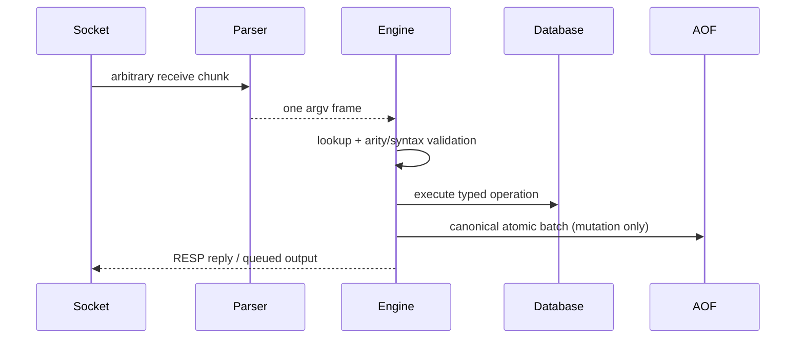

# Architecture

## Execution model

KeyForge uses one level-triggered Linux `epoll` loop for accept, client I/O, command
execution, active expiry, and reply scheduling. A command completes before another client
can mutate the database, which gives commands and EXEC batches simple atomicity without
locks around the keyspace. `everysec` AOF synchronization is the only background work.
It shares only the AOF descriptor and state behind a mutex; it never accesses database
objects.

`signalfd` converts SIGINT/SIGTERM into an event-loop input. This avoids asynchronous
signal handlers and lets shutdown close clients and flush persistence on the owning
thread.

## Connection lifetime and buffering

The listener and accepted sockets are non-blocking and close-on-exec. Accept and receive
loops continue through `EINTR` and drain work until `EAGAIN`. Each connection owns:

- an RAII socket;
- an incremental RESP parser and input buffer;
- an output byte string plus partial-write offset;
- transaction queues and watched versions.

Epoll stores a monotonically increasing connection token rather than a raw fd. The token
maps to current connection state, preventing a stale event from accidentally targeting a
new socket that reused the same descriptor number. `EPOLLOUT` is enabled only while bytes
remain. Sends use `MSG_NOSIGNAL`; peer shutdown, reset, and epoll error flags remove both
the connection and any pub/sub memberships.

Input, bulk-value, client-count, and pending-output limits are configuration values. A
protocol/input violation receives an error when possible and then closes. If a reply or
pub/sub message would exceed the output limit, the slow client is disconnected. This is
the server's explicit backpressure policy.

## RESP parser

The parser owns bytes because views into the receive buffer would be invalidated by
growth. `feed` appends within the client-buffer limit and `next` returns exactly one of:

1. complete value (and consumes only that frame),
2. incomplete input (retaining every byte), or
3. an invalid-frame diagnostic.

Type-byte dispatch parses simple strings, errors, integers, bulk strings, and nested
arrays. Header integers use `std::from_chars` with exact-consumption and overflow checks.
Length and depth checks occur before allocation. Bulk bodies are binary-safe
`std::string`s, including embedded NULs. Pipelined bytes remain for the next call.

## Dispatch and data ownership



The command registry centralizes case-insensitive names, arity, mutating status,
transaction control, and pub/sub safety. Network code converts only arrays of bulk
strings into argv and has no storage semantics.

The database owns a map of typed entries. Its value variant contains binary strings,
deques, hash maps, hash sets, and `SortedSet`. A sorted set maintains both
member-to-score lookup and an ordered `(score, member)` set, giving numeric ordering with
lexicographic ties. A mutation updates both indexes before returning. Containers are
removed when their final element is deleted; no command performs implicit type conversion.

## Expiration

Entries optionally contain an absolute Unix-millisecond persistence deadline, a monotonic
runtime deadline, and a unique expiry token. Updating a TTL pushes a new
`(monotonic deadline, key, token)` min-heap record rather than
searching the heap. When a record reaches the top, it is ignored unless the key still has
the same token and deadline. Every lookup performs lazy expiry. Each event-loop turn also
processes at most 64 due/stale records, bounding latency during expiry waves. A key is
expired when `now >= deadline`.

The clock is an interface. Tests inject exact millisecond values and never sleep. Runtime
scheduling and remaining-TTL replies use the monotonic deadline, while AOF uses the Unix
deadline. Replay converts the persisted deadline back into a monotonic remaining duration.

## Transactions and WATCH

MULTI state belongs to a connection. Known commands receive centralized arity and syntax
validation before being queued; a queue-time error marks the transaction invalid. EXEC
first compares each watched key's recorded version, then executes queued commands without
returning to epoll. Runtime errors become array elements and do not roll back prior work.

Versions live outside entries, so an absent key can be watched. Creation, value mutation,
TTL change, deletion, expiry, and every key removed by a graph cascade advance its
version. Checking a version first performs lazy expiry, which makes expiration conflicts
visible. EXEC, DISCARD, UNWATCH, and disconnect clear relevant session state.

## Pub/sub indexes

Two indexes provide efficient fan-out and cleanup:

```text
channel -> set<connection token>
connection token -> set<channel>
```

PUBLISH snapshots and sorts recipients, returns the subscriber count, and gives the
network layer one RESP message per recipient. Delivery only appends to normal output
buffers; it never blocks the publisher on socket I/O. A subscribed connection is limited
to registry-marked safe commands. Disconnect walks only that connection's channels.
Messages are never sent to persistence.

## Dependency graph

Edges point from a parent source to a dependent child. The graph stores both parent and
dependent adjacency sets. Before adding `parent -> child`, cycle detection asks whether
the parent is reachable from the child through dependent edges; all proposed parents are
checked before any edge is committed. Self-edges are rejected and duplicates are no-ops.

Cascade discovery is iterative breadth-first traversal with a visited set and sorted
children, so diamonds are de-duplicated and deep graphs do not consume the C++ call stack.
The closure is collected before keys/edges are erased. Ordinary DEL removes only named
entries and incident edges; expiry and `KFG.INVALIDATE` use the closure.

## AOF write and replay

Successful mutations are canonicalized after execution. SET conditions are removed once
their outcome is known; a successful relative TTL becomes SET plus absolute PEXPIREAT.
All records for one user command or EXEC are wrapped in a single RESP MULTI/EXEC batch.
This framing makes a partially written tail non-applicable.

The `always` policy writes and `fdatasync`s before returning success. `everysec` writes
before replying and lets a synchronized worker perform the sync; `no` relies on kernel
writeback. The worker owns no keyspace references and is always joined.

Startup streams the AOF through the same RESP parser and dispatcher in replay mode.
Replay suppresses new AOF writes and live pub/sub. Expiration is paused until graph
registration has replayed, then due roots cascade. The reader tracks the latest completed
outer batch. An incomplete final frame or batch is truncated back to that boundary;
invalid syntax or a replay error at any earlier point aborts startup with a byte offset.

## Failure boundaries

Expected socket failures remove only the affected client. Exceptions are caught at each
event dispatch boundary, logged, and never escape through the loop. Listener, epoll,
signal, client, and AOF descriptors are RAII objects. Startup does not bind until config
and AOF recovery succeed. AOF write/sync failure changes the command reply to a `MISCONF`
error; the in-memory mutation may already have occurred, and operators should stop the
server and resolve storage failure before continuing.
